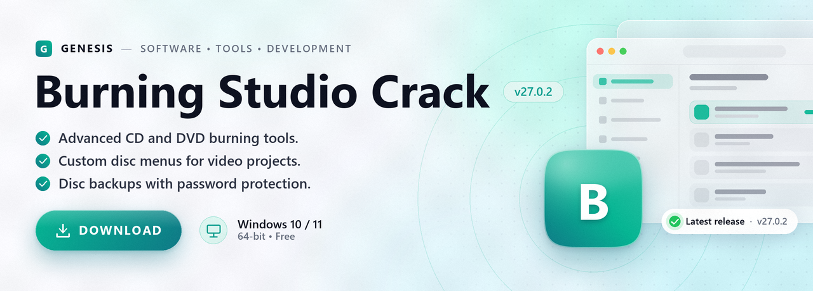

# Burning Studio - Windows 10 & 11

## Introduction

Burning Studio is a software application designed to facilitate the creation, editing, and management of audio and video discs on Windows 10 and Windows 11. It serves as a solution for users who need to burn files onto CDs, DVDs, or Blu-ray discs, allowing for easy organization and playback of multimedia content. This is particularly beneficial for those who prefer physical media storage or need to create copies for sharing or backup purposes.

Users can expect a straightforward interface that simplifies the burning process. The software provides features such as disc compilation, file conversion, and the ability to create custom menus for DVDs. With this tool, users can efficiently manage their audio and video files, ensuring that they are preserved and easily accessible.

In an era where digital media is predominant, the ability to create physical copies of videos and audio files remains relevant. Burning Studio addresses this need by offering an array of functionalities tailored for both novice and experienced users. Whether you aim to compile a music collection, create a home video DVD for family gatherings, or back up important data, Burning Studio is equipped to assist you in achieving your goals.

---

## System Requirements

| Requirement          | Details                         |
|---------------------|---------------------------------|
| Supported OS        | Windows 10, Windows 11         |
| Architecture        | x64 (64-bit)                   |
| Processor           | Not specified                   |
| RAM                 | Not specified                   |
| Storage             | Not specified                   |
| Permissions         | Administrator permissions may be required for installation |
| Internet Connection  | Not specified                   |

**Additional Notes:**

While specific hardware requirements such as processor speed, RAM, and storage space are not specified, it is recommended that users have a modern computer with at least 4GB of RAM and a dual-core processor for optimal performance. Sufficient disk space is also necessary to store temporary files during the burning process. A CD, DVD, or Blu-ray drive is essential for writing data to physical media.

---

## Features

- **Disc Creation**: Easily create CDs, DVDs, and Blu-ray discs using a simple drag-and-drop interface. This feature allows users to compile various audio and video files into a single disc efficiently. For instance, if you have a collection of family videos from a vacation, you can compile them into a DVD for playback on a standard DVD player.

- **File Conversion**: Convert files to different formats suitable for burning. This ensures compatibility with various media players and devices. For example, if you have a video file in a format that your DVD player does not support, Burning Studio can convert it to a compatible format before burning.

- **Custom Menus**: Create personalized menus for DVD projects, enhancing the viewing experience. Users can add chapters, titles, and background music to make their discs more interactive. This is particularly useful for creating a professional-looking DVD for a wedding or an event, where you can navigate easily between different sections.

- **Multi-Session Support**: Burn discs in multiple sessions, allowing users to add files later without erasing existing data. This feature is essential for users who want to gradually compile data onto a disc, such as creating a music CD where you might want to add new tracks over time.

- **Audio Tools**: Includes audio editing tools that let users adjust volume levels, trim tracks, and merge audio files. This makes it easier to prepare music compilations for burning. If you want to create a party mix, you can seamlessly merge various tracks and ensure that the volume levels are consistent throughout.

- **Data Backup**: Efficiently back up important files onto physical media, providing a reliable way to store data. This feature is particularly useful for archiving sensitive information, such as personal documents or important work files, ensuring that they are preserved even in the event of a system failure.

- **User-Friendly Interface**: Designed with ease of use in mind, the intuitive interface guides users through the burning process with minimal learning curve. The clear layout allows users to navigate functions easily, making it accessible to users of all experience levels.

- **Support for Various Formats**: Supports a wide range of audio and video formats, ensuring that users can burn nearly any file type they have. This versatility is crucial for users with diverse media collections.

- **Verification Process**: Automatically verifies the data after burning to ensure that the disc is correctly written and playable. This feature reduces the likelihood of errors, giving users confidence that their burned discs will work as intended.

- **Template Library**: Access to a library of templates for disc labels and covers, allowing users to create professional-looking media presentations. This feature can enhance the aesthetics of your physical media, making it more appealing for sharing or gifting.

---

## How It Works

1. **Install Burning Studio**: Download and install the software on your Windows 10 or Windows 11 system, following the on-screen prompts to complete the setup. Ensure that you have the necessary administrator permissions to install the software.

2. **Select Your Media Type**: Choose whether you want to create an audio CD, video DVD, or data disc. The interface will guide you through the specific steps for your selection. For example, if you select "Video DVD," the software will prompt you to add video files and then guide you through creating custom menus.

3. **Compile Your Files**: Drag and drop your files into the designated area. Arrange them as needed and use any editing tools if necessary to prepare the content for burning. You can also check the total size of your compilation against the capacity of the disc you are using.

4. **Burn the Disc**: Once your compilation is ready, insert a blank disc into your drive and click the burn button. The software will handle the rest, including verification. During this process, you can monitor the burning progress and receive notifications upon completion.

---

## Compatibility

**Operating Systems and Architecture**  
Burning Studio is compatible with Windows 10 and Windows 11 operating systems, specifically for x64 architecture. Users should ensure that they are using a compatible version to avoid potential functionality issues.

**Hardware Requirements**  
While specific hardware requirements have not been detailed, a standard modern PC with a CD/DVD/Blu-ray drive is necessary for burning media. Users should ensure that their optical drive is functioning correctly and is capable of handling the type of media they plan to use.

**Runtime Dependencies**  
No specific runtime dependencies have been mentioned in the provided documentation. However, it is advisable to keep your Windows operating system updated to the latest version to avoid any compatibility issues.

**Limitations and Notes**  
Users should be aware that some features may be limited based on the version of Windows or the hardware capabilities of their system. Always consult the official documentation for the most accurate information. If you encounter problems, ensure that your software is updated to the latest version.

---

## FAQ

### What is Burning Studio used for?
Burning Studio is primarily used for creating audio and video discs by allowing users to compile files onto CDs, DVDs, or Blu-ray discs. It is particularly useful for those who want to store multimedia content physically, create backups, or prepare files for sharing.

### How do I install Burning Studio on my Windows PC?
To install Burning Studio, download the installer from a reliable source, then run the setup file. Follow the on-screen instructions to complete the installation process. You may need administrator permissions to install the software.

### Is Burning Studio compatible with Windows 11?
Yes, Burning Studio is compatible with both Windows 10 and Windows 11, allowing users to utilize its features on the latest version of the Windows operating system.

### Can I create custom menus for my DVDs?
Yes, Burning Studio allows users to create custom menus for their DVD projects. This feature enables you to add chapters, titles, and background music, enhancing the overall viewing experience.

### What should I do if I encounter issues while burning?
If you experience issues while burning, ensure that your disc drive is functioning properly and that you are using compatible media. Check for software updates or consult the help section within the application for troubleshooting tips. If problems persist, it may be helpful to restart your computer and try the process again or consult the community forums for additional support.

---

## Disclaimer

Details regarding features and compatibility may vary by version and system configuration. Users are advised to back up important data before making significant changes to their systems or using the software. It is also recommended to test the burning process with a rewritable disc before committing to a permanent disc to avoid unnecessary waste.

---

## License

The software license for Burning Studio is not explicitly stated in the available documentation. Users should consult the license distributed with the software or the vendor's official terms for clarification on usage rights and restrictions. This may include limitations on distribution, modification, or commercial use. Users are encouraged to review the license agreement thoroughly to ensure compliance.

--- 

In conclusion, Burning Studio is a comprehensive solution for users looking to create, edit, and manage their multimedia content efficiently. With its extensive features and user-friendly interface, it caters to both casual users and those who require more advanced functionalities. By following the installation steps and utilizing the various features, users can easily produce professional-quality discs for personal or professional use.
